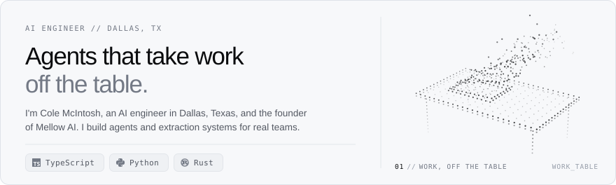
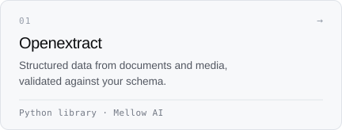
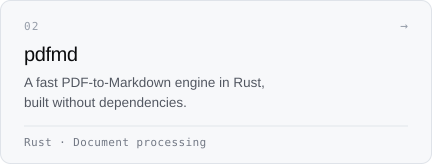
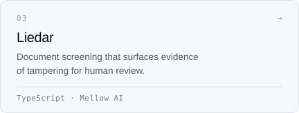
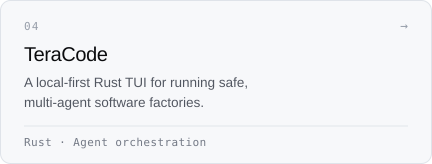

<a href="https://colemcintosh.io">
  <picture>
    <source media="(prefers-color-scheme: dark)" srcset="assets/hero-dark.svg">
    <source media="(prefers-color-scheme: light)" srcset="assets/hero-light.svg">
    
  </picture>
</a>

Engineer & founder of [Mellow AI](https://staymellow.ai) &nbsp;·&nbsp; [colemcintosh.io](https://colemcintosh.io) · [Blog](https://colemcintosh.io/blog) · [Resume](https://colemcintosh.io/resume) · [LinkedIn](https://www.linkedin.com/in/colemcintosh/) · [X](https://x.com/colesmcintosh) · [Email](mailto:cole@staymellow.ai)

---

### `02` &nbsp;Selected work

<p>
  <a href="https://github.com/Mellow-Artificial-Intelligence/openextract"><picture><source media="(prefers-color-scheme: dark)" srcset="assets/work-openextract-dark.svg"><source media="(prefers-color-scheme: light)" srcset="assets/work-openextract-light.svg"></picture></a>
  <a href="https://github.com/colesmcintosh/pdfmd"><picture><source media="(prefers-color-scheme: dark)" srcset="assets/work-pdfmd-dark.svg"><source media="(prefers-color-scheme: light)" srcset="assets/work-pdfmd-light.svg"></picture></a>
</p>
<p>
  <a href="https://github.com/Mellow-Artificial-Intelligence/liedar"><picture><source media="(prefers-color-scheme: dark)" srcset="assets/work-liedar-dark.svg"><source media="(prefers-color-scheme: light)" srcset="assets/work-liedar-light.svg"></picture></a>
  <a href="https://github.com/colesmcintosh/teracode"><picture><source media="(prefers-color-scheme: dark)" srcset="assets/work-teracode-dark.svg"><source media="(prefers-color-scheme: light)" srcset="assets/work-teracode-light.svg"></picture></a>
</p>

### `03` &nbsp;Open source

- **[mev](https://huggingface.co/stay-mellow-ai/mev)** — Qwen3.5-4B fine-tuned for structured decisions. Open weights and evaluation.
- **[LiteLLM](https://github.com/BerriAI/litellm/pulls?q=is%3Apr+is%3Amerged+author%3Acolesmcintosh)** — Added providers, SSO, health checks, guardrails, and cost tracking.
- **[Pydantic AI](https://github.com/pydantic/pydantic-ai/pulls?q=is%3Apr+is%3Amerged+author%3Acolesmcintosh)** — Added xAI search and attachments, input token counting, and provider settings.
- **[smolagents](https://github.com/huggingface/smolagents/pulls?q=is%3Apr+is%3Amerged+author%3Acolesmcintosh)** — Fixed Enum execution, added Bedrock API-key support, and improved agent tests.

### `04` &nbsp;Work

| Role | Company | Years |
| :--- | :--- | ---: |
| **Founder** | [Mellow AI](https://staymellow.ai) | `2025 – Present` |
| **AI & Data Engineer** | [Pay Ready](https://payready.com) | `2023 – 2025` |
| **Scaled Tooling Analyst** | [Cloud Kitchens](https://tryotter.com) ([now Atoms](https://atoms.co)) | `2022 – 2023` |
| **Business Analyst** | [RealPage](https://realpage.com) | `2021 – 2022` |

[Full resume →](https://colemcintosh.io/resume)

### `05` &nbsp;Blog

- **[Everything Is Computer](https://colemcintosh.io/blog/everything-is-computer)** — Harbor turns jobs into containers, instructions, and graders. The bottleneck is the test.
- **[Every Max Coding Agent Plan, Tested](https://colemcintosh.io/blog/every-max-coding-agent-plan)** — Four $200 coding agents on the same work. Which surface makes it disappear?
- **[Python to TypeScript in One Evening](https://colemcintosh.io/blog/porting-openextract)** — Parallel agents and fast inference made the port possible. Deciding what exists stayed hard.

[All posts →](https://colemcintosh.io/blog)

### `06` &nbsp;MCP

Point a coding agent at this URL to read the resume. Streamable HTTP, no auth.

```text
https://colemcintosh.io/mcp
```

---

<sub>[cole@staymellow.ai](mailto:cole@staymellow.ai) · [colemcintosh.io](https://colemcintosh.io) · [LinkedIn](https://www.linkedin.com/in/colemcintosh/) · [X](https://x.com/colesmcintosh) · [RSS](https://colemcintosh.io/rss.xml) · [llms.txt](https://colemcintosh.io/llms.txt)</sub>
